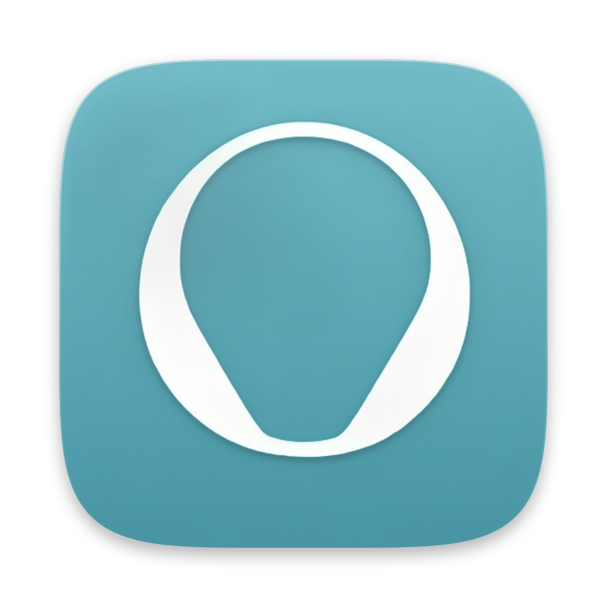
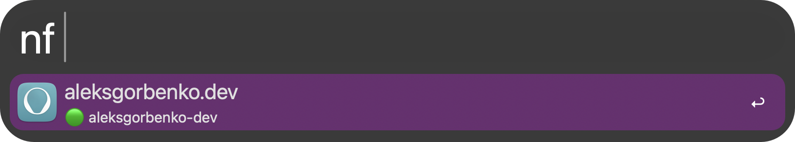

<p align="center">
  
</p>

<h1 align="center">Netlify for Alfred</h1>

<p align="center">Browse Netlify sites, deploys and settings from Alfred.</p>

<p align="center">
  <a href="https://github.com/aleksgorbenko/alfred-workflow-netlify/actions/workflows/ci.yml"></a>
  <a href="https://github.com/aleksgorbenko/alfred-workflow-netlify/releases/latest"></a>
  <a href="LICENSE"></a>
  
  <a href="https://www.alfredapp.com/powerpack/"></a>
</p>

<p align="center">
  <a href="#commands">Commands</a> ·
  <a href="#install">Install</a> ·
  <a href="#setup">Setup</a> ·
  <a href="#development">Development</a>
</p>

Type `nf` to list your Netlify sites with their latest deploy status.



Alfred Workflow to browse [Netlify](https://www.netlify.com) sites via the [Netlify API](https://docs.netlify.com/api/get-started/).

## Commands

### `nf <query>` - browse your Netlify sites

The query is a path; delete its last part to go back. Text after the last part filters the page.

| Path | Page |
|---|---|
| `nf <query>` | Sites, filtered by name or domain |
| `nf <site> >` | Site: Builds, Environment variables, Settings, Open live site, Trigger deploy |
| `nf <site> > builds` | Builds, newest first, with 🟢/🔴/🟡 status and the failure reason |
| `nf <site> > builds > <id>` | Build detail: preview, build log, commit, branch, state, timing |
| `nf <site> > env` | Environment variables |
| `nf <site> > settings` | Build and domain settings |

- First row on every page is the page itself: `↩` opens it in Netlify, `⇥` goes back.
- `↩` on a site, section or build - go into it.
- `⌘↩` on a site - trigger a new deploy.
- `⌥↩` on a site - open its Netlify dashboard.
- `⌃⌥↩` on a site - open the live site.
- `⌥↩` on a build - open its deploy preview.
- `⌃↩` on an active build - cancel it.
- `↩` on an env var - copy `KEY=value`; `⌘C` copies the value only.
- `↩` on a detail or setting - copy it, or open it when it is a link.

### Maintenance

- `:nf` - cache size (`↩` reveals the folder) and Empty Cache.

## Install

1. Download the latest `Netlify.alfredworkflow` from [Releases](https://github.com/aleksgorbenko/alfred-workflow-netlify/releases).
2. Double-click it - Alfred will prompt to import.
3. Requires [Alfred](https://www.alfredapp.com) with a Powerpack licence.

## Setup

1. Open the workflow in Alfred, click the `[x]` (Configure Workflow) button.
2. Paste your Netlify Personal Access Token into the **Netlify Personal Access Token** field (User Settings > Applications > Personal access tokens > New access token).

## Development

- Python 3.14, stdlib only.
- `src/nfapi/` - runtime scripts Alfred calls.
- `tools/` - dev-only scripts (bundle verification), not shipped.

```sh
make setup   # install dev tools and the Python environment
make ci      # everything CI runs
make check    # lint + format check + tests
make build    # package dist/Netlify.alfredworkflow
make verify   # audit the built bundle for local paths, tokens, junk files
make release VERSION=v1.0.0
make sync-plist WORKFLOW_DIR=/path/to/installed/workflow   # pull info.plist edits back
make link-live WORKFLOW_DIR=/path/to/installed/workflow    # symlink src/ for live dev
```

## My Other Workflows

- [Discogs for Alfred](https://github.com/aleksgorbenko/alfred-workflow-discogs)
- [WaniKani for Alfred](https://github.com/aleksgorbenko/alfred-workflow-wanikani)
- [2Do for Alfred](https://github.com/aleksgorbenko/alfred-workflow-2do)
- [BunPro for Alfred](https://github.com/aleksgorbenko/alfred-workflow-bunpro)
- [Bandcamp for Alfred](https://github.com/aleksgorbenko/alfred-workflow-bandcamp)
- [config](https://github.com/aleksgorbenko/config) - index of all my workflows, plus macOS/iOS setup
